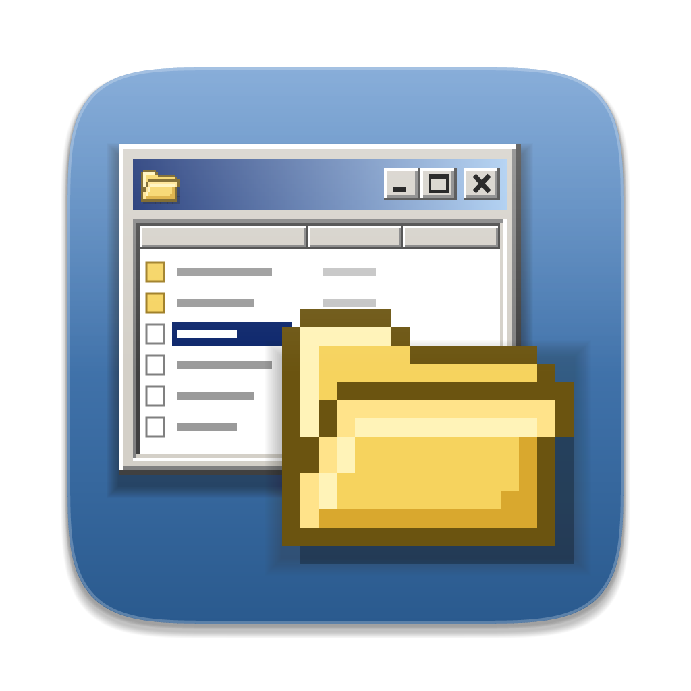
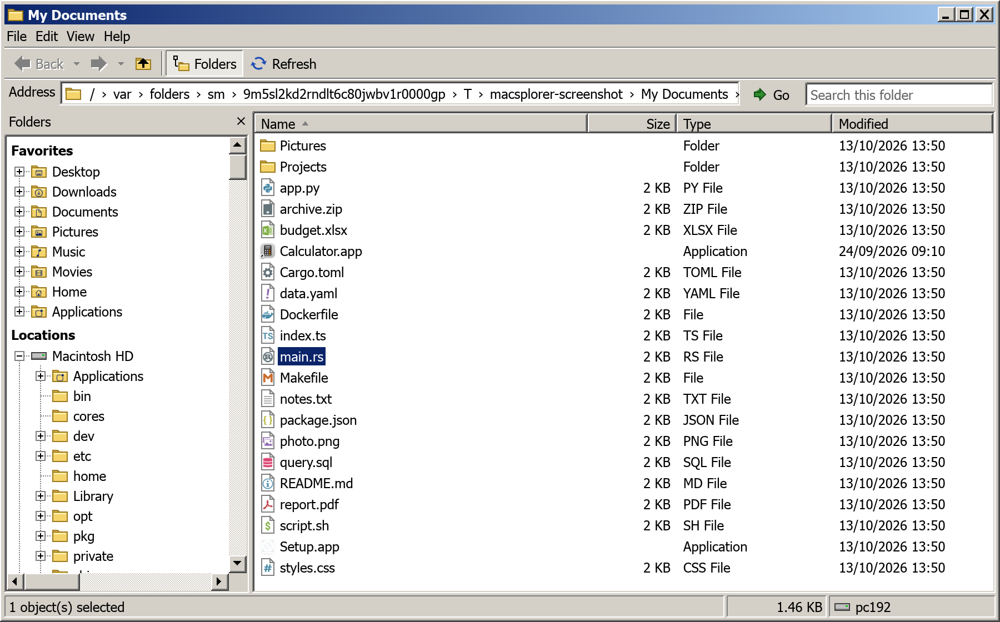

<p align="center">
  
</p>

<h1 align="center">Macsplorer</h1>

<p align="center">
  <strong>The Windows 2000 Explorer you remember, as a native file browser for macOS and Linux.</strong><br>
  Written in Rust. Always-on folder tree, a real address bar, classic bevels and Tahoma font.
</p>

<p align="center">
  
</p>

<p align="center">
  <a href="docs/manual/README.md"><strong>User manual</strong></a> ·
  <a href="#install">Install</a> ·
  <a href="https://github.com/jbrunemann/macsplorer/releases/latest">Download</a>
</p>

Macsplorer is a file browser for people who think better with a folder tree on the left, the full path on top and a details list in the middle. It looks like Windows 2000 "Windows Classic", behaves like Explorer where that matters, and still opens your files with the apps you already use.

## Why use it

- **A real folder tree.** The Folders pane stays on screen and follows you:
  the tree expands to and selects the folder you're in. Finder's sidebar is
  a list of shortcuts, and its column view hides the rest of the hierarchy.
- **An address bar you can read and type into.** Every segment of the path is
  a button, each `›` opens a menu of subfolders, and ⌘L turns the bar into a
  text field (`~` works). The full path is always visible.
- **Details view that never gets in the way.** Sortable Name / Size / Type /
  Modified columns, in place rename with Explorer's selection rule (name
  without extension), and no hover highlights jumping around under your mouse.
- **File types you can recognize at a glance.** Every document is the classic
  paper page with a colored emblem from the VS Code "Seti" icon theme: Rust,
  TypeScript, Dockerfile, Makefile, YAML, SQL and hundreds more.
  Apps and anything with a custom Finder icon keep the real macOS icon.
- **Favorites with Finder's glyphs.** Desktop, Downloads, Documents, Pictures,
  Music, Movies, Home and Applications carry their Finder symbol on the
  yellow folder, so you find them the way you already know.
- **Status bar that tells you something.** Object count, total size of the
  selection (or the folder), the free space of the disk you're on and the name
  of your machine, like the original.
- **Never freezes on a big folder.** Listings run on background threads, so a
  huge directory or a slow volume doesn't lock up the window.
- **Hidden files and extensions on your terms.** Toggle both from the View
  menu. File extensions that could make an app pass for a document
  (`Invoice.pdf.app`) always stay visible.
- **Small, fast and open.** A single native Rust binary, no account, no
  telemetry, MIT licensed.
- **Because it looks great.** Gradient caption bar, 3D bevels, classic scroll
  bars, dotted tree lines with +/− boxes. Nothing else on macOS looks like it.

New to Macsplorer? Read the **[user manual](docs/manual/README.md)**: it walks through every feature with screenshots, in plain language.

## Install

**Download:** grab `Macsplorer-macOS.zip` from the
[latest release](https://github.com/jbrunemann/macsplorer/releases/latest),
unzip it and drag `Macsplorer.app` to Applications. It's a universal build
(Apple silicon and Intel, macOS 11 or later).

The app isn't notarized, so the first launch is blocked by Gatekeeper. Either
right-click the app and choose **Open**, or clear the quarantine flag once:

```sh
xattr -dr com.apple.quarantine /Applications/Macsplorer.app
```

**Build from source:** you need a recent Rust toolchain.

```sh
git clone https://github.com/jbrunemann/macsplorer.git
cd macsplorer
scripts/bundle-macos.sh --open        # builds target/release/Macsplorer.app
```

Or run it straight from the source tree:

```sh
cargo run --release -p macsplorer -- [folder]   # defaults to your home folder
```

### Linux (experimental)

Download `Macsplorer-linux-x86_64.tar.gz` from the
[latest release](https://github.com/jbrunemann/macsplorer/releases/latest), unpack it and run
`./macsplorer [folder]`; `README.txt` inside shows how to install the desktop
entry. Or build it with `scripts/bundle-linux.sh`. It needs a Wayland or X11
desktop with Vulkan or OpenGL, and the usual `libxkbcommon` and `libwayland`
or `libx11` libraries.

Differences from macOS: Delete moves to the freedesktop Trash, Show in File
Manager uses the `FileManager1` D-Bus interface (falling back to `xdg-open`),
Eject uses `gio` or `umount`, volumes come from `/media`, `/run/media` and
`/mnt`, shortcuts use Ctrl instead of ⌘, and the window gets resize handles on
its frame. **Open With** is not available yet, and apps keep the paper-page
icon instead of a native one. This port is built and tested in CI but hasn't
had much real-world use, so expect rough edges.

Macsplorer uses Tahoma and reads it from the system fonts at runtime, it isn't
bundled. macOS ships it. On Linux install it (Wine and the `msttcorefonts`
package have it) or egui's default font is used.

## Features

- **Large Icons**, **List** and **Details** views (View menu). Details has Name / Size / Type / Modified columns; click a header to sort, click again to reverse. Drag a divider to resize a column (Esc cancels), double-click it to fit the contents; widths apply to every folder until the window closes. *Explorer-derived* (comctl32 `SysHeader32`).
- Large Icons follows the Windows 2000 list view: 75 px slots, names wrapped under the icon and cut to two lines (the focused item shows its full name), and arrow keys that move to the nearest icon in that direction. *Explorer-derived* (comctl32 `SysListView32`).
- List fills columns top to bottom with small icons, every column as wide as the longest name, and scrolls sideways (the mouse wheel too). ↑↓ step through the items, ←→ jump a column. *Explorer-derived* (same source).
- Folders first, natural name sorting (`file2` before `file10`). *Explorer-derived* (`StrCmpLogicalW`); turn it off under View.
- Click, ⌘-click and ⇧-click selection, arrow keys, double-click or Enter to open (files open in their default app).
- **Marquee selection**: drag a dotted rectangle from empty space (in Details, anywhere beside a name) to select what it touches; ⌘ toggles items, ⇧ adds to the selection, Esc clears it, and the view scrolls when you drag past its edge. *Explorer-derived* (comctl32 `CLVSelectionManager::DragSelect`).
- Right-click an item for **Open**, **Open With**, **Show in Finder**, **Open in Terminal** (folders), **Eject** (volumes), **Cut**, **Copy**, **Copy as Path**, **Paste** (into a folder), **Delete**, **Rename** and **Properties**. Right-click empty space for **Paste**, **Refresh**, **Open in Terminal** and **Properties** of the open folder.
- **Open in Terminal** starts Terminal on macOS; on Linux `$TERMINAL`, else the first common terminal found. Set `"terminal"` in `settings.json` (an app name such as `iTerm` or `Ghostty` on macOS, a command on Linux) to use another one.
- **Cut, Copy and Paste** files and folders (⌘X / ⌘C / ⌘V). Pasting next to an existing name creates "Name - Copy.ext", "Name - Copy (2).ext", as Explorer does; a move never overwrites. Cut items are drawn faded until pasted.
- **Delete** (⌦ forward delete, or ⌘⌫) moves the selection to the Trash.
- **Undo** (toolbar button, Edit menu or ⌘Z) reverses the last rename, move, copy or delete, up to 10 steps back. Undoing a delete restores the items from the Trash.
- **Properties** (⌘I, File menu or right-click): the Windows 2000 General page in its own window, with name (editable, renames on OK or Apply), type (Finder's Kind, e.g. "Microsoft Excel Workbook"), location, size, and for folders the number of files and folders inside, counted in the background. Files also show created, modified and accessed dates, folders their created date. *Explorer-derived* (shell32 `CFilePropSheetPage`).
- Dates and numbers follow the system locale (macOS Language & Region settings), in Properties, the Modified column and the status bar.
- **Copy as Path** (⌘⌥C) puts the selected items' quoted full paths on the clipboard. *Explorer-derived* (`CCopyAsPathMenu`).
- **F2 / right-click → Rename**, in place. The initial selection follows Explorer's rule (name without extension, whole name for folders, dotfiles and hidden extensions). *Explorer-derived* (`SHBeginLabelEdit`). Enter or clicking away commits, Esc cancels, `/` can't be typed.
- Back / forward / up / refresh. Right-click back or forward for the history list.
- Breadcrumb address bar: click a segment to go there, `›` for a subfolder menu, click empty space or ⌘L to type a path (`~` works).
- Search box filters the current folder by name.
- **Navigation pane tree** (modeled on Explorer's `CNscTree`): Favorites and Locations roots, folders only, natural-sorted, packages left out. Children load on background threads with a "Loading…" row; chevrons appear only on folders that have subfolders. Click a name to open it, click the chevron or double-click to expand. Arrow keys follow tree conventions (← collapses or goes to the parent, → expands or goes to the first child). Refresh reloads expanded folders.
- **Expand to open folder** (View menu, on by default): the tree expands to and selects the folder you're in, under the most specific root (`~/Documents/x` opens under Documents, not Home).
- Menus: File › Properties, Close; Edit › Undo, Cut, Copy, Copy as Path, Paste, Delete, Select All (⌘A), Invert Selection; View › Explorer Bar › Folders, Large Icons / List / Details, file name extensions, hidden files, expand to open folder, natural sorting, Refresh; Help › Open config file, About.
- Toolbar **Folders** button (or the × on the pane) shows and hides the Folders pane; **Views** picks Large Icons, List or Details.
- Status bar: object count and free disk space (or the selection count), size of the selection (or of the folder), and the machine name.

| Shortcut | Action |
|---|---|
| ⌘[ · ⌥← · ⌫ | Back |
| ⌘] · ⌥→ | Forward |
| ⌘↑ · ⌥↑ | Up |
| ⌘R · F5 | Refresh |
| ⌘L | Edit path |
| F2 | Rename |
| Enter | Open |
| ⌘A | Select all |
| ⌘X · ⌘C · ⌘V | Cut · Copy · Paste |
| ⌘⌥C | Copy as Path |
| ⌦ · ⌘⌫ | Move to Trash |
| ⌘Z | Undo |
| ⌘I | Properties |

## Not yet

File watching (FSEvents, so the list updates live), drag and drop, window persistence, pinning favorites, multiple windows and tabs.
For file operations: no replace/skip dialog on name conflicts (copies get a
"- Copy" name, moves stop with an error), no progress window, no redo and no
Shift+Delete. Small Icons and Thumbnails views are still to come.

## How it's built

Behaviors marked "Explorer-derived" were traced from Windows 10 build 10240
binaries (`ExplorerFrame.dll`, `shell32.dll`, `Windows.Storage.dll`,
`comctl32.dll`) and are documented with their evidence in [`docs/`](docs/).
The code is written from those behavioral notes, not copied from decompiled
output.

| Crate | Purpose |
|---|---|
| `crates/macsplorer-core` | UI-independent logic: listing, sorting, rename rules, copy/move, history, breadcrumbs, sidebar places, the Folders tree model, Seti icon lookup, the Large Icons and List layouts, marquee selection, column header resizing and the Properties folder size walk. Unit-tested. |
| `crates/macsplorer` | The app (egui/eframe). |
| `tools/make-icon` | Renders the app icon and `.icns`. |

```sh
cargo test --workspace
cargo clippy --workspace --all-targets
cargo test -p macsplorer -- --ignored   # renders the window offscreen to target/screenshots/*.png
cargo run -p make-icon                  # regenerates assets/icon.png and macsplorer.icns
```

**Look.** A Windows 2000 "Windows Classic" theme
(`crates/macsplorer/src/theme.rs`): system colors, 3D bevels, Tahoma, a
gradient caption bar that replaces the macOS title bar, flat toolbar buttons
that pop out on hover, a dotted-line Folders tree with +/− boxes, and
hand-drawn 16×16 icons. The app icon is a macOS-style squircle in the Windows
2000 desktop blue, holding a classic window and a pixel-art folder.

**File icons.** Files are the Windows 2000 dog-eared paper page. Recognized
types carry a colored emblem from **Seti**, VSCodium's default file icon
theme, resolved like VS Code: exact file name, then the most specific
extension (`spec.ts` before `ts`), then language id. Unrecognized types get
the plain page with gray text lines. App bundles, other packages and items
with a Finder custom icon show the icon macOS shows
(`NSWorkspace.iconForFile`), rendered lazily and cached. Folders are the
yellow Windows 2000 folder, with the Finder SF Symbol on the user folders that
have one, or a Git branch glyph (drawn as vector shapes after Ionicons' `git-branch-outline`, MIT, so Linux gets it too) on the top folder of a Git working tree (a
`.git` folder or file inside; the Finder symbol wins).

## Credits and license

MIT licensed. The Seti font, theme map and the extension → language table come
from the VS Code repository (MIT; see `assets/seti/` for licenses). Refresh
them with `scripts/update-seti.py`.
