# Macsplorer User Manual

Macsplorer is a file browser for your Mac. It looks and works like the Windows 2000 Explorer: a folder tree on the left, your files on the right, and the full path of where you are along the top. You can use it next to Finder or instead of it. Your files open in the same apps as always.

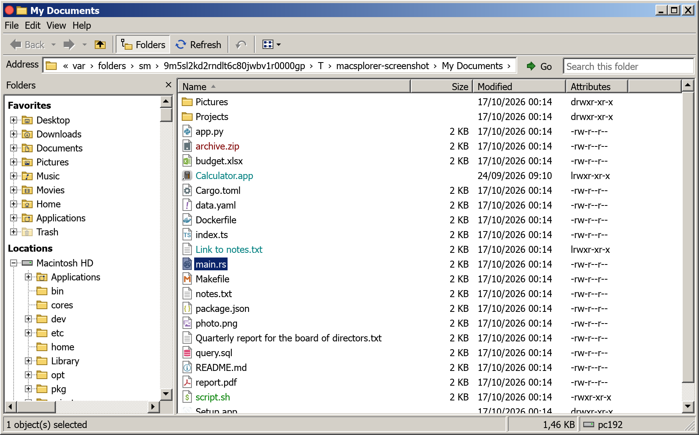

**Contents**

1. [Getting started](#1-getting-started)
2. [The window at a glance](#2-the-window-at-a-glance)
3. [Getting around](#3-getting-around)
4. [Choosing how files are shown](#4-choosing-how-files-are-shown)
5. [Selecting files](#5-selecting-files)
6. [Opening files](#6-opening-files)
7. [Renaming](#7-renaming)
8. [Copying, moving and deleting](#8-copying-moving-and-deleting)
9. [Undo](#9-undo)
10. [Properties](#10-properties)
11. [Finding files](#11-finding-files)
12. [Making it your own](#12-making-it-your-own)
13. [Keyboard shortcuts](#13-keyboard-shortcuts)
14. [Questions and answers](#14-questions-and-answers)

---

## 1. Getting started

**Installing.** Unzip the download and drag **Macsplorer** into your **Applications** folder.

**The first launch.** Your Mac may warn that it can't check Macsplorer for harmful software, because the app isn't registered with Apple. To open it anyway, right-click (or Control-click) Macsplorer in Applications, choose **Open**, then confirm with **Open**. You only need to do this once.

**Where it starts.** Macsplorer opens in your home folder, the one with your name on it.

**More windows.** Choose **File › New Window** (⌘E, or ⌘N) to open a second window, for example to copy files from one folder to another. Each new window opens on the folder you're in and appears slightly offset from the one before.

**Closing.** Click the folder icon in the top left corner (it turns into a red dot when you point at it) or the **×** in the top right corner, choose **File › Close**, or press ⌘Q.

## 2. The window at a glance

From top to bottom:

| Part | What it does |
|---|---|
| **Title bar** | Shows the name of the folder you're in. Drag it to move the window. The folder icon at the far left turns into a red dot when you point at it, and clicking it closes the window, as on other Mac windows. The buttons on the right minimize, maximize and close the window, and double-clicking the bar also maximizes it. |
| **Menu bar** | File, Edit, View and Help. |
| **Toolbar** | Back, Forward, Up, Folders, Refresh, Undo and Views. Hold the pointer over a button to see what it does and its shortcut. |
| **Address bar** | The path to the current folder. You can click any part of it. |
| **Search box** | To the right of the address bar. Shows only the items whose name contains what you type. Press **/** to go there. |
| **Folders pane** | On the left: your favorite places, your disks, and all the folders on them as a tree. |
| **File list** | On the right: the contents of the current folder. |
| **Status bar** | At the bottom: how many items there are, how big they are, how much free space the disk has, and your computer's name (click it to receive files from nearby devices, see [Receiving files from a phone or computer nearby](#receiving-files-from-a-phone-or-computer-nearby)). Inside a Git repository it also shows the branch and the state of the repository (see [Git repositories](#git-repositories)). Drag the ridged corner at its right end to make the window bigger or smaller. |

### Git repositories

While you are anywhere inside a Git repository, the status bar gets an extra pane with the branch symbol and a summary in the format of [posh-git](https://github.com/dahlbyk/posh-git#git-status-summary-information):

`[main ≡ +0 ~2 -1 | +1 ~1 -0 !]`

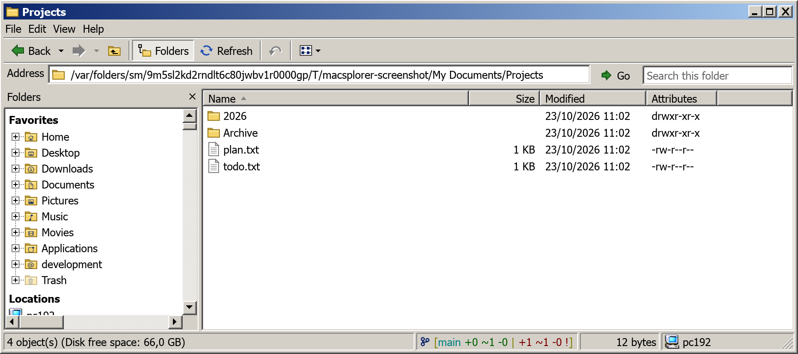

- The branch name comes first, or `(abc1234...)` when you are not on a branch. While a merge or rebase is under way it says so, for example `main|MERGING`.
- Next to the branch: `≡` means it matches its remote, `↑3` that you are 3 commits ahead (time to push), `↓2` that you are 2 behind (time to pull), `↓2 ↑3` both, and `×` that its remote branch is gone. Nothing means it has no remote.
- Before the `|` are the staged changes (added `+`, modified `~`, removed `-`, conflicted `!`), after it the ones that are not staged yet. Files Git doesn't know yet count as added.
- A final `!` says there are changes that are not staged, `~` that everything that changed is staged.

To see which folders are Git repositories, turn on the **Branch** column (right-click a column heading, see [Details](#details)). It shows the branch of every folder that is a repository, and nothing for the rest.

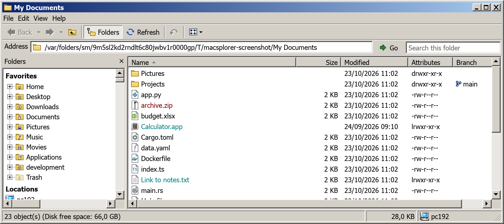

The summary and the **Branch** column need Git to be installed. Without it they are simply left out. The summary is worked out when you enter a repository and kept while you move around inside it, so big repositories stay quick. It is worked out again with **View › Refresh**, after you change something in Macsplorer, and when another program changes the folder you're looking at. Changes deeper inside the repository show up at the next refresh.

## 3. Getting around

### The Folders pane

The tree on the left has three sections:

- **Favorites**: your home folder, Desktop, Downloads, Documents, Pictures, Music, Movies, Applications and the Trash. Shortcuts (symbolic links) to folders that you keep directly in your home folder are listed too, just above the Trash.
- **Locations**: your Mac, shown by its own name with a little monitor icon (it is only a label, nothing opens from it), then your Mac's disk, plus any USB sticks, external drives or network disks you have connected. As in Windows 2000's My Computer, each kind of drive has its own icon: a gray drive for the Mac's own disk, the same with a slot for USB sticks, external drives and mounted disk images, a disc over a drive for CDs and DVDs, and a drive with a cable for disks on the network.
- **Network**: **Network Neighborhood**, the phones, tablets and computers nearby that you can send files to. See [Sending to a phone or computer nearby](#sending-to-a-phone-or-computer-nearby) and [Receiving files from a phone or computer nearby](#receiving-files-from-a-phone-or-computer-nearby).

Click a folder's name to open it. Click the small **+** box (or double-click the name) to unfold the folders inside it without leaving where you are, and **−** to fold them away again. With the keyboard, the arrow keys move up and down, → unfolds and ← folds, + and − do the same without moving, Home and End jump to the first and last folder, and Page Up and Page Down move a pageful at a time. Typing the first letters of a folder's name jumps to it, among the folders you can see. When you move with the keys, the folder opens on the right half a second after you stop, so you can run through the tree quickly without waiting for every folder on the way.

As you move around, the tree follows you: it unfolds to and highlights the folder you're in. To turn that off, uncheck **View › Expand to open folder**.

Right-click a folder in the tree for **Open**, **Properties**, and **Eject** for disks you can safely remove. **File › Eject** does the same for the disk the open folder is on, and is dimmed when that disk can't be ejected (your Mac's own disk). The menu also has **Expand to current folder**, which takes the tree back to the folder you're looking at: it unfolds the way there, selects the folder and scrolls it into the middle. Use it when you have scrolled or folded the tree away, or when **Expand to open folder** is off. It's in the menu for empty space in the pane too.

To hide the pane and give the files more room, click **Folders** on the toolbar or the **×** at the top of the pane. Click **Folders** again to bring it back.

### The address bar

The address bar shows the path of the folder you're in, written the way you would type it. Your home folder is written as **~**, as in Terminal, so `~/Documents/Taxes` is the Taxes folder inside your Documents. When the path is too long to fit, its first part is cut off and the end, the folder you're in, stays. Rest the pointer on the path to see it in full, for example `/Users/yourname/Documents/Taxes`.

To go somewhere else by path, click the address bar or press ⌘L (F4 and ⌥D work too), type the location and press Enter (or click **Go**). The path starts out in the form you can type back: inside your home folder it is written with a **~**, so `~/Documents` is your Documents folder and `~` alone is your home folder. Paths outside it are written in full. Only a **~** on its own or followed by `/` means your home folder. `~name`, another user's home folder in a shell, is not looked up and is taken as typed. Quotes around a pasted path, as Terminal or **Copy as Path** add them, are left out. If you type the path of a file, Macsplorer opens the folder that holds it and selects the file. Press Esc to stop typing and go back to the folder you're in.

While you type a folder's path, Macsplorer guesses the folder you mean and shows the rest of its name in gray after what you typed, as the Fish shell does. Press → , End or Tab to accept it (Tab only does this while a guess is showing; otherwise it moves on to the search box as always), and the name and a `/` are filled in; keep typing to ignore it. After you press Backspace or Delete there is no guess until you type again, so it doesn't bring back what you just deleted.

To see what is in the folder you are typing without leaving the field, press ↓. The file list below then shows the guessed folder, or the folder you have typed so far, and keeps following what you type. Nothing is opened yet: press Enter to go there, or Esc to get your own folder back. Enter and **Go** always use exactly what you typed. The guess is a folder inside the folder you have typed so far, and it appears once you type the first letter of the name. You don't have to type accents: **A** finds **Äpfel**, as long as no folder starts with a plain **A**. A hidden folder is only guessed when you start its name with a dot.

### Go To Folder

To get to a folder without clicking through the tree or typing its whole path, press **⇧⌘G** (or choose **View > Go To Folder...**). A small window opens with a box and a list. Type a few letters of the folder's name and the list narrows to the folders that contain those letters in that order: **dwn** finds **Downloads**. The best match comes first, with names that start with what you typed ahead of the rest, then the others in this order: folders you have been to in this window (latest first), the places in the Folders pane such as Desktop and your disks, the folders open in the Folders pane, and the folders in the current folder. Each shows where it is in gray. Type a **/** to match on the whole path instead.

**↑** and **↓** (or **Ctrl+P** and **Ctrl+N**) move through the list, Page Up and Page Down move eight at a time, **Enter** or a double-click goes there, and **Esc** closes the window. On Linux, the shortcut is **Ctrl+Shift+G**.

### Back, Forward and Up

- **Back** returns to the folder you were in before, and **Forward** goes ahead again after going back. The small arrow beside each one shows a list of the places you've been, so you can jump several steps at once.
- **Up** goes to the folder that contains the current one.
- **Refresh** reloads the list and the Folders pane. You rarely need it: when another program adds, removes, renames or changes files in the folder you're looking at, or in a folder that is open in the Folders pane, Macsplorer updates by itself within a second.

## 4. Choosing how files are shown

Pick a view under **View**, or with the **Views** button at the right of the toolbar.

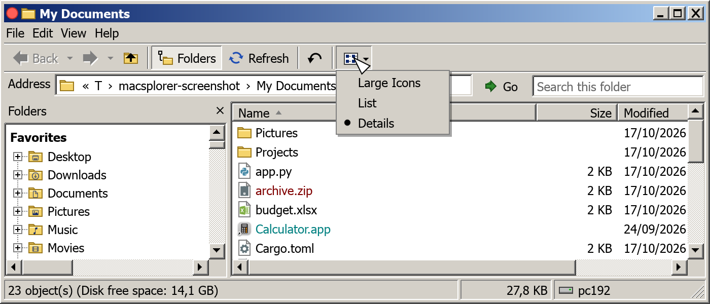

### Details

A table with one row per item and columns for its name, size, the date it was last changed and its attributes. This is the view the app starts in.

- **Sort** by clicking a column heading. Click it again to reverse the order. Name and the other columns start from A to Z or oldest first; Size and Modified start with the biggest and the newest. The small triangle shows which column is sorted and in which direction.
- **Resize a column** by dragging the line between two headings. Double-click the line to make the column just wide enough for its contents. Press Esc during the drag to cancel.

**Choosing columns.** Right-click any column heading to turn columns on or off.

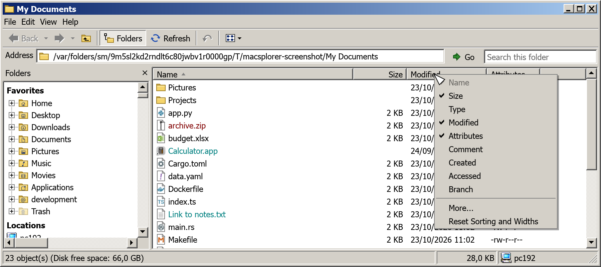

The available columns are:

| Column | Shows |
|---|---|
| **Name** | The item's name. This one is always shown. |
| **Size** | How big a file is. Folders are left blank. |
| **Type** | What kind of file it is, for example "Plain Text Document". |
| **Modified** | When it was last changed. |
| **Attributes** | Who may read, change or run it (see [Properties](#10-properties)). |
| **Comment** | The comment you gave it in Finder's Get Info window. |
| **Created** | When it was made. |
| **Accessed** | When it was last opened. |
| **Owner**, **Group** | Which user and group it belongs to. |
| **Branch** | The Git branch of a folder that is a Git repository, with the branch symbol in front. Blank for everything else. |

Choose **Reset Sorting and Widths** at the bottom of that menu to sort by name again and give every column its original width. The columns you have shown stay as they are.

Choose **More...** above it for the **Column Settings** window. There you can check and uncheck columns, put them in a different order with **Move Up** and **Move Down**, and type an exact width for the selected column.

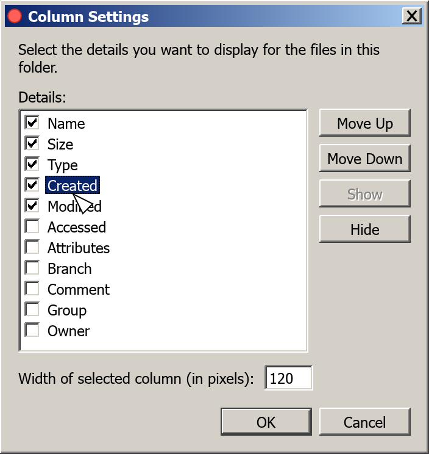

Your columns, their order and their widths are the same in every folder and every window, and Macsplorer remembers them for next time.

### Large Icons

Big icons laid out in rows, with the names underneath. Long names are cut short after two lines. Click one to see its full name.

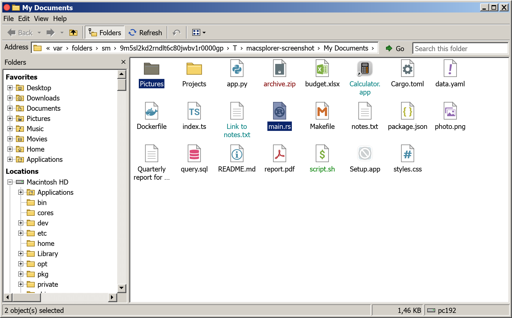

### List

Small icons with names, arranged in columns that run from top to bottom. When there are more items than fit, the list scrolls sideways.

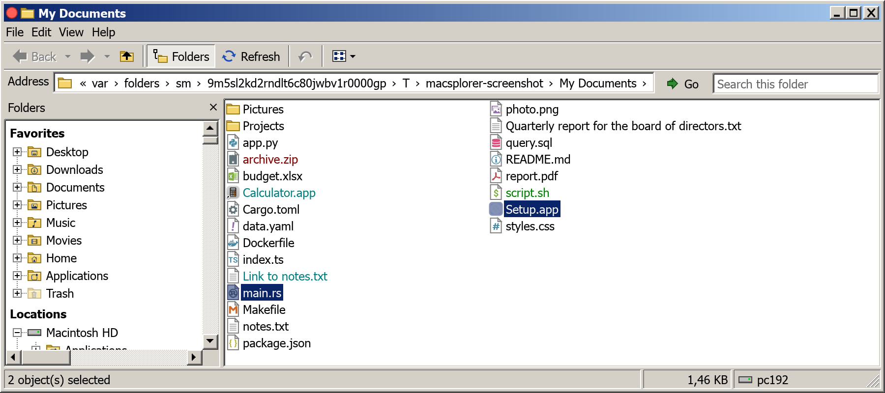

### What the icons tell you

- **Yellow folders** are folders. The ones in your Favorites carry a small symbol, the same one Finder uses for them.
- **A zipper** marks zip and tar archives: on a folder in Large Icons, on a paper page in the List and Details views. Show Package Contents opens them as a folder (see [Archives](#archives-zip-and-tar-files)). While you're inside one, the address bar shows the folder with the zipper.
- **Paper pages** are files. A colored mark on the page shows the kind of file, for example a spreadsheet, a picture, a PDF or a program's source code. A plain page with gray lines is a file of a kind Macsplorer doesn't know.
- **Apps**, and anything you have given a custom icon in Finder, show their real icon.

### Colored names

With **View › Special files in color** turned on (it is at first), some names are colored so they stand out:

- **Green**: programs and scripts that can be run.
- **Turquoise**: links (aliases) that point to another file or folder.
- **Red**: archives such as `.zip` files and disk images, and links whose original has gone missing. Only the ones with a [zipper](#what-the-icons-tell-you) on their icon can be looked into with Show Package Contents; the others, such as `.rar` or `.dmg`, can't.

## 5. Selecting files

- **Click** an item to select it.
- **⌘-click** to add an item to the selection, or to take it out again.
- **⇧-click** to select everything between the item you selected first and this one.
- **Drag** from an empty spot to draw a dotted rectangle: everything it touches gets selected. In Details you can start beside a name. Hold ⌘ while dragging to switch items on and off, or ⇧ to add to what's already selected. If you drag past the edge, the list scrolls along.
- **Edit › Select All** (⌘A) selects everything in the folder, and **Edit › Invert Selection** swaps what's selected and what isn't.
- **Arrow keys** move the selection. In Large Icons they move to the nearest icon in that direction. Hold ⇧ to select everything from the first item to where you move.
- **Space** adds the item with the dotted focus rectangle to the selection, or takes it out again. ⇧-Space selects everything from the first item to it.
- **Type the first letters** of a name to jump to it. Typing `re` quickly selects the first item starting with "re". Pause for a second to start over.

The status bar shows how many items you have selected and how much space they take up together.

## 6. Opening files

- **Double-click** an item, or select it and press Enter. Folders open in Macsplorer, and files open in the app your Mac normally uses for them.
- **Right-click** an item for more choices:

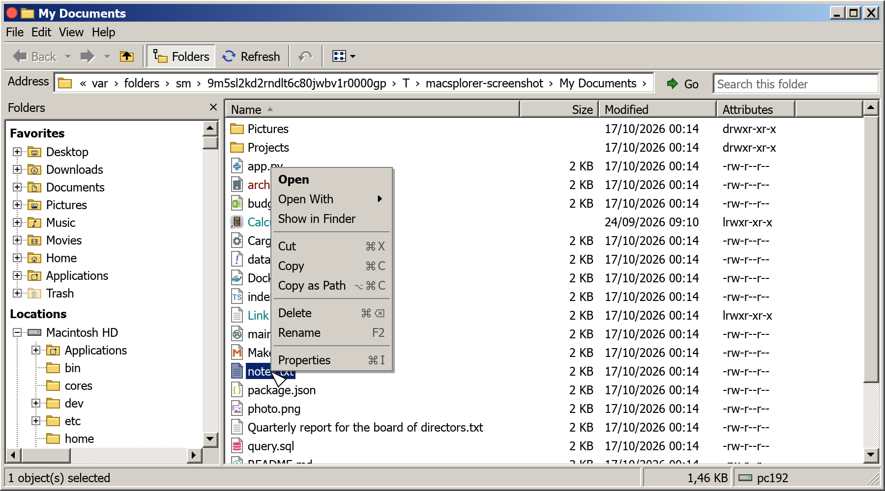

| Choice | What it does |
|---|---|
| **Open** | Same as a double-click. |
| **Show Package Contents** | For apps, other packages and zip and tar archives: shows the files inside them as a folder instead of opening them. **Back** returns to where you were. |
| **Open With** | Pick another app to open the file with. The apps that can open it are listed with their icons, and the one the file opens with now (the one you chose, or else the Mac's default) is in bold and comes first. **Choose Program...** opens a list where you pick an app (the current one is marked "(default)"), or use **Other...** for any app on your Mac. Tick **Always use this program to open these files** and double-clicking that kind of file (all `.jpg` and `.jpeg` files, say) opens it with that app from then on, in Macsplorer only. Finder isn't affected. |
| **Extract All...** | For `.zip` and `.tar` archives: copies everything in the archive into a folder. See [Archives](#archives-zip-and-tar-files). |
| **Extract...** | Inside an archive: copies the selected items into a folder. |
| **Show in Finder** | Opens a Finder window with the item selected. |
| **Open in Terminal** | For folders: opens a Terminal window in that folder. Also in the Folders pane's menu, and in the menu for empty space (for the open folder). |
| **Eject** | For disks and drives: safely disconnects them. |
| **Send To** | Sends the selected items to a phone or computer nearby that runs LocalSend. See [Sending to a phone or computer nearby](#sending-to-a-phone-or-computer-nearby). |
| **Cut**, **Copy**, **Copy as Path**, **Paste**, **Move Here** | See [Copying, moving and deleting](#8-copying-moving-and-deleting). |
| **Delete** | Moves the item to the Trash. |
| **Rename** | See [Renaming](#7-renaming). |
| **Properties** | See [Properties](#10-properties). |

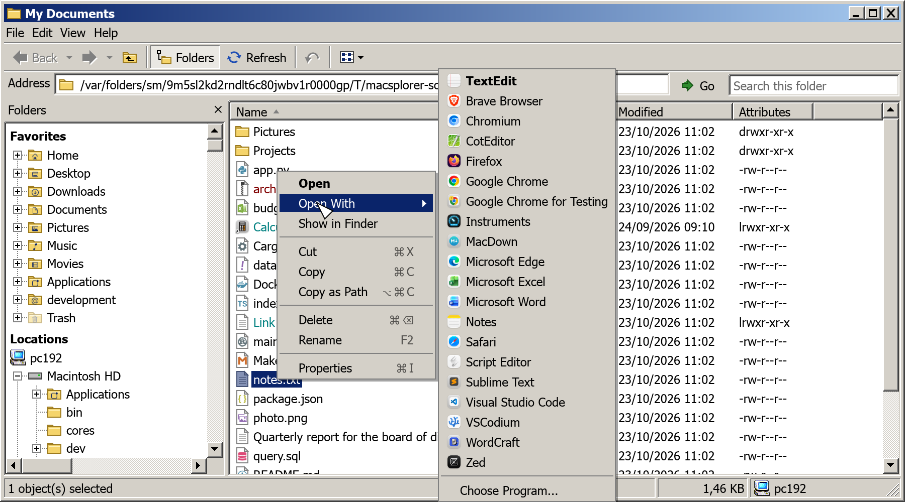

Right-click an empty spot in the list for **Paste**, **Move Here**, **Refresh**, **New**, and **Properties** of the folder you're in. **New › Folder** makes a folder called New Folder (or New Folder (2) and so on if that name is taken) and lets you type its name right away.

### Archives (zip and tar files)

An archive is handled like an app: double-clicking it opens it with its program (Archive Utility, say), and **Show Package Contents** in its menu shows what's inside as a folder, like Windows' compressed folders. This works for `.zip`, `.tar`, `.tar.gz` (or `.tgz`), `.tar.bz2`, `.tar.xz` and `.tar.zst` files, with folders you can go into. Typing the archive's path in the address bar does the same. The address bar shows the way in, for example `~/Downloads/photos.zip/2026`, with the archive's name in red (when [colored names](#colored-names) are on), and **Up** or **Back** takes you out again. Their icon has a zipper. Other kinds of archive (`.7z`, `.rar`, `.cab`) keep their page icon and still open in their own app.

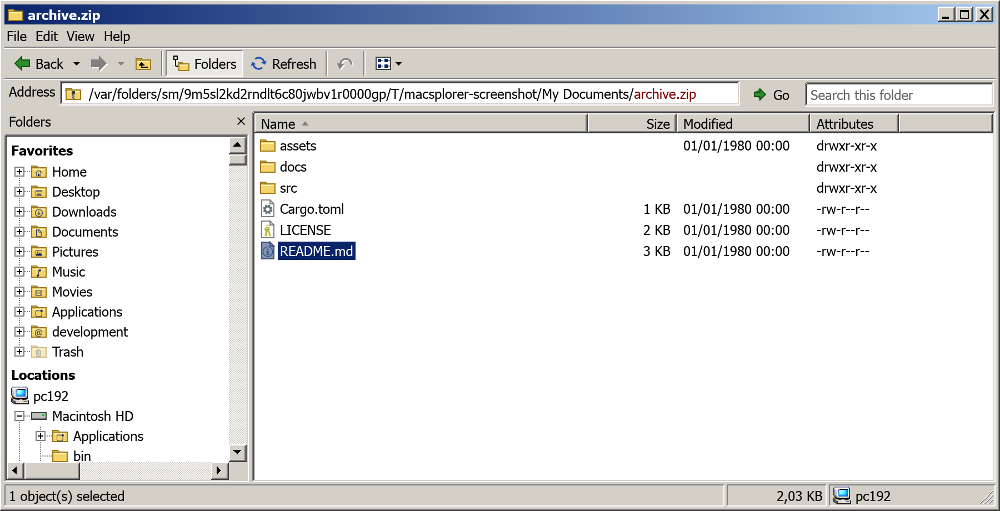

What's inside an archive can be looked at and copied, but not changed: **Rename**, **Delete**, **Cut**, **Paste** and **New Folder** aren't available there. To change the files, extract them first.

- **Open a file** by double-clicking it. Macsplorer takes a copy out of the archive and opens that, so changes you make to it don't go back into the archive. An app inside an archive is taken out whole before it starts.
- **Copy** files and paste them somewhere else, or **drag** them to a folder, to Finder or to another app. Dragging out of the window works for up to 64 MB at a time; for more, use Copy and Paste or Extract All.
- **Extract...** (in the **File** menu or the menu for an item inside the archive) copies just the items you selected, one or many, into a folder. It asks for the folder the same way Extract All does, and folders come out with everything in them.
- **Extract All...** (in the **File** menu, in the menu for the archive, or by right-clicking an empty spot inside it) copies everything into a folder. It suggests a folder next to the archive with the archive's name (or one in your Documents folder when the archive is in a temporary folder). Type another place if you like; `~` stands for your home folder. With **Show extracted files when complete** ticked, Macsplorer goes to that folder afterwards; Macsplorer remembers whether you ticked it.

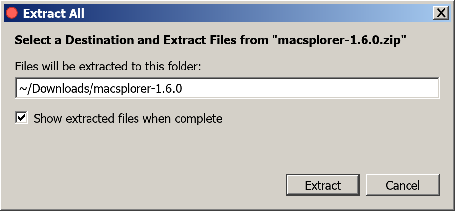

A **password-protected zip** asks for its password the first time you open, copy or extract something from it, and remembers it until you close the window. If the password is wrong, it asks again.

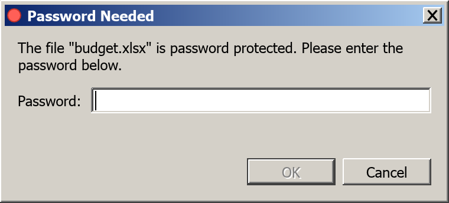

Files that came from the internet stay marked that way when they come out of the archive, so your Mac checks an app from a downloaded zip before it opens, just as it does when you unzip it in Finder. The copies Macsplorer makes to open files are kept in its cache folder and removed a day later.

## 7. Renaming

Start renaming in any of these ways:

- select the item and press **F2**,
- right-click it and choose **Rename**,
- or click the name of an item that's already selected, then wait a moment. If you'd rather not have this, turn off **View › Click to rename**.

The name turns into a text box. Only the part before the extension is selected, so you can type a new name straight away without losing the `.txt` or `.pdf` at the end.

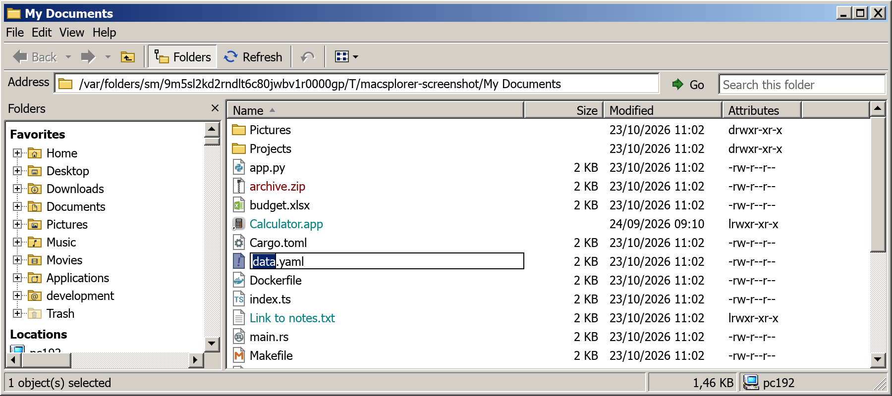

Press **Enter** or click somewhere else to keep the new name. Press **Esc** to cancel. The `/` character can't be used in a name. If an item with that name already exists, nothing is changed and the status bar tells you why.

## 8. Copying, moving and deleting

### Copy and Paste

1. Select the items and choose **Edit › Copy** (⌘C).
2. Go to the folder where you want them.
3. Choose **Edit › Paste** (⌘V).

You can also right-click a folder in the list and choose **Paste** to put the items straight into it.

If you paste into the folder the items came from, each copy is called "Name - Copy", then "Name - Copy (2)" and so on.

### When the name is already taken

If the folder you paste into already has an item with the same name, Macsplorer asks what to do:

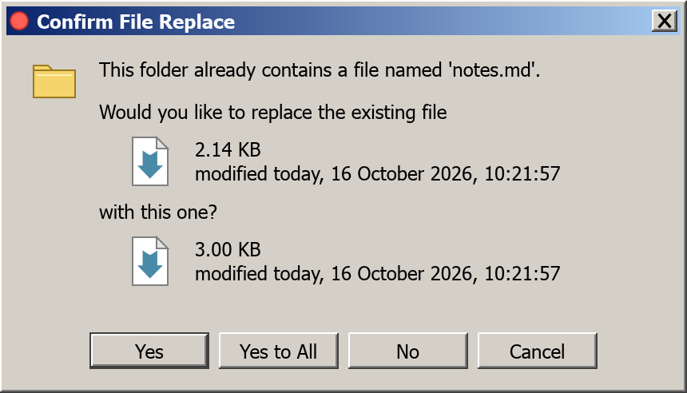

- **Yes** replaces the item that's there. It isn't lost: it goes to the Trash, and ⌘Z brings it back.
- **Yes to All** replaces this one and every other item with a name that's taken, without asking again.
- **No** leaves both alone and goes on with the next item.
- **Cancel** stops. What was already copied or moved stays where it is.

When a folder goes into a folder of the same name, the two are merged: the contents end up together in one folder. If none of the names inside clash, this happens without a question. If some do, Macsplorer first asks whether to merge the folders, then asks about each file whose name is taken.

### Watching it work

When copying or moving takes more than a second, a window shows how it's going: the item it's working on, where it goes, a bar, and about how long is left.

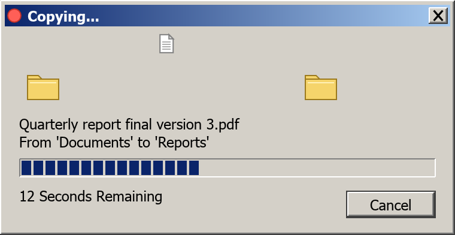

**Cancel** (or Esc) stops it. What was already copied or moved stays where it is, and the item that was halfway is left out completely: no half-copied files. If that item was replacing one with the same name, the old one is put back.

### Cut and Paste (moving)

Use **Edit › Cut** (⌘X) instead of Copy to move the items. They are shown faded until you paste them somewhere. If the destination already has an item with the same name, Macsplorer asks first, as described above.

### Dragging

You can also move items by dragging them with the mouse. Press on an item (or on one of several selected items), hold the button and move: the items follow the pointer, faded. A folder you move over is highlighted, and letting go puts the items into it. Letting go over empty space in the list puts them into the folder you're looking at. Folders in the Folders pane take items too, and a closed one opens if you hold the pointer over it for a moment.

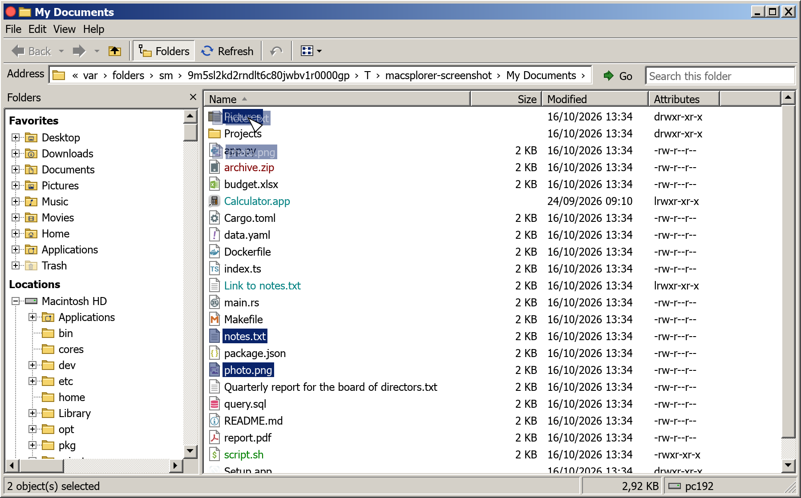

What happens depends on where the items go, as in Finder:

- On the same disk they are **moved**.
- To another disk (a USB stick, a network drive) they are **copied**.
- Hold **⌥ Option** while letting go to copy instead, or **⌘ Command** to move.
- Hold **⌥ Option** and **⌘ Command** together to make a **shortcut** instead: a small file that opens the original. It's called "Name - Shortcut".

The pointer shows what will happen: a plus sign for a copy, a little arrow for a shortcut, and a "no" sign where the items can't go, such as onto a file or into the folder they came from. Press **Esc** while dragging to call it off. A drag into a Macsplorer window can be undone with ⌘Z like any other move or copy.

Drag items out of the window to put them in a Finder window, on the desktop, into another Macsplorer window or another app, or onto the Trash in the Dock. Items dragged from Finder can be dropped on Macsplorer in the same way.

On Linux, files dragged from another file manager such as Nautilus go into the folder you're looking at: moved when they are on the same disk, copied otherwise. This works in an X11 session, or on Wayland when Macsplorer is started with `WINIT_UNIX_BACKEND=x11`. Dragging out of the window isn't there yet; use Copy and Paste inside Macsplorer.

### Sending to a phone or computer nearby

Macsplorer can send files to phones, tablets and computers on the same Wi-Fi or network that run [LocalSend](https://localsend.org), a free app for Android, iPhone, iPad, Windows, Mac and Linux. Nothing has to be set up: open LocalSend on the other device and leave it open.

In the Folders pane, click the **+** next to **Network Neighborhood** under **Network**. Macsplorer looks for LocalSend on your network, which takes a few seconds, and lists every device it finds by the name LocalSend gives it, with the LocalSend logo. Point at a device to see what kind of device it is and its network address. Click **−** to stop looking; right-click Network Neighborhood and choose **Search Again** if a device you just started doesn't show up. While it looks, the last row under Network Neighborhood says which part of the network it is asking, such as "Searching 10.11.46.x (38%)". Right-click that row and choose **Cancel** to stop looking; devices already found stay in the list, and ones that announce themselves are still added. On a big network (a phone in another range than your Mac) the search can take a minute or more the first time; Macsplorer remembers where it found devices and looks there first the next time.

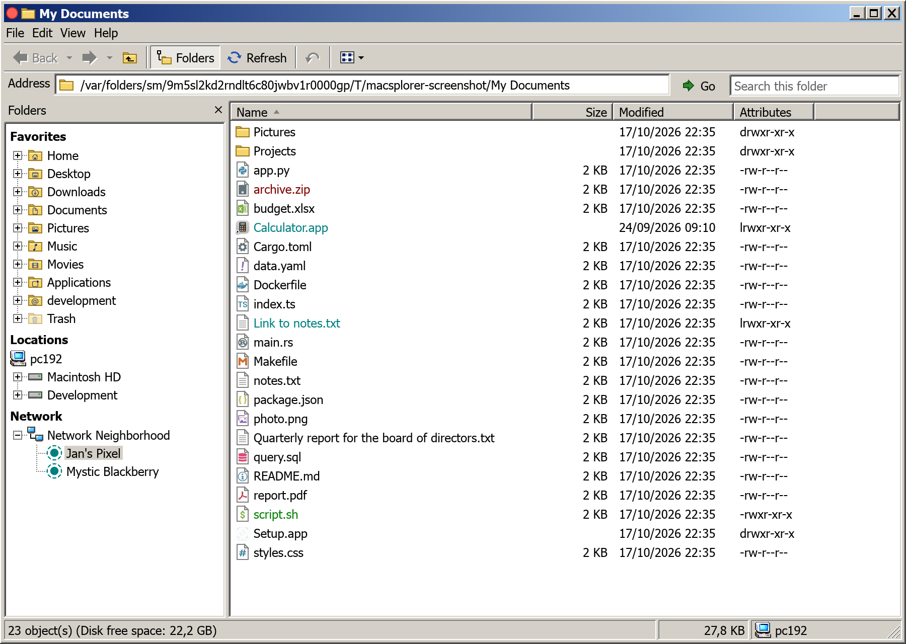

To send, do one of these:

- Drag files or folders onto a device in the Folders pane.
- Right-click the selected items and choose **Send To**, then the device. The Send To menu starts looking on its own when Network Neighborhood is closed, so a device may take a moment to appear in it.
- Right-click a device and choose **Send Selected Items**.

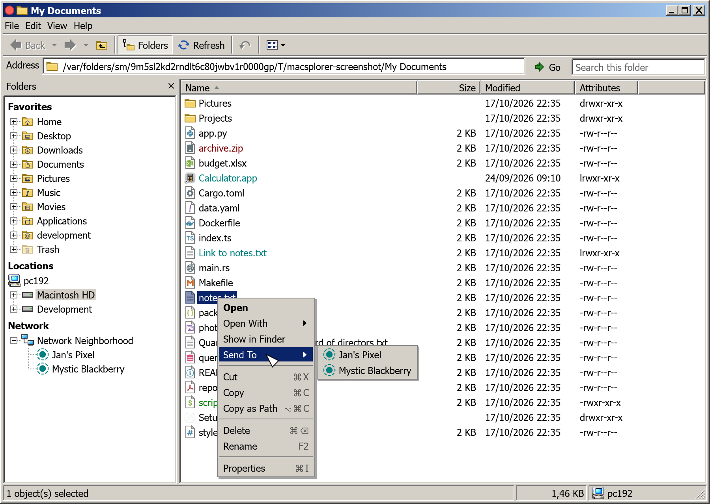

The other device asks whether to accept the files, and the "Sending..." window waits until someone answers there. Once they accept, it shows how far it has got; **Cancel** stops it. A folder arrives as a folder with everything in it. The status bar says when the files have arrived, or why they didn't: declined, a device that is busy with another transfer, or one that asks for a PIN (not supported yet; switch the PIN off in LocalSend's settings on that device).

Sending can't be undone: the files are on the other device.

The first time, your Mac may ask whether Macsplorer may find devices on your local network. Choose **Allow**; if you said no, switch Macsplorer on in **System Settings › Privacy & Security › Local Network**.

### Receiving files from a phone or computer nearby

Macsplorer can also take files that a phone, tablet or computer sends with LocalSend. This is off until you turn it on: right-click **Network Neighborhood** and choose **Receive Files**, or click your computer's name at the right end of the status bar and choose it there. Macsplorer remembers it, in every window, until you turn it off the same way.

While it is on, other devices list your Mac in LocalSend under the name in the status bar, and a hand under the computer there and under Network Neighborhood's icon shows that your Mac is open to them, the way Windows showed a shared folder. Point at the computer to see the name the others see.

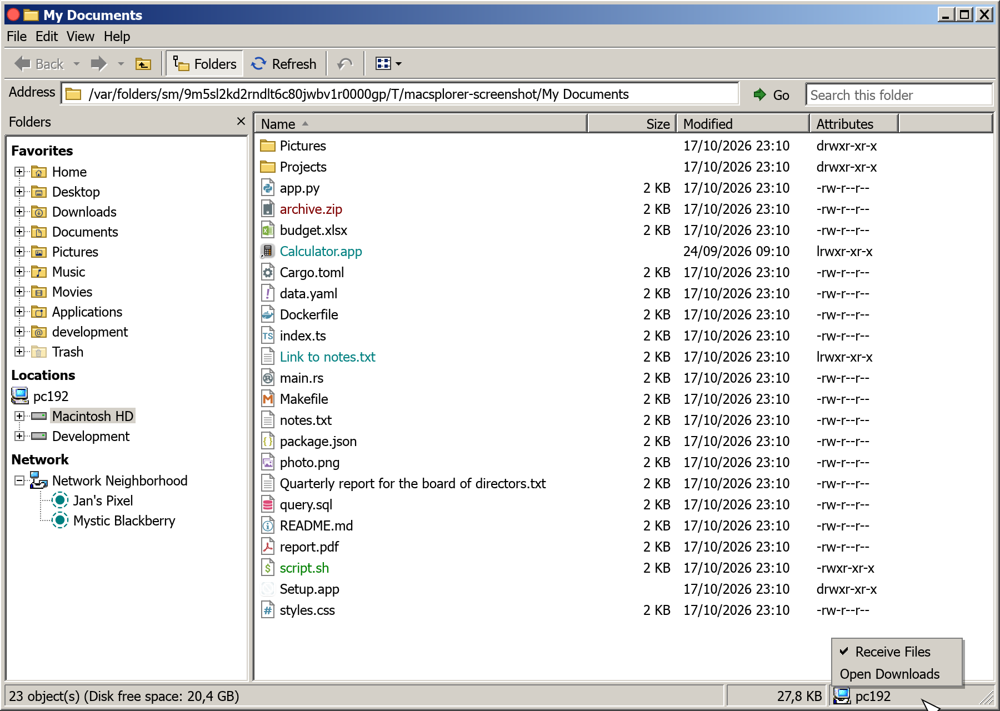

When someone sends you files, Macsplorer asks first. It shows who is sending, from what kind of device and network address, and which files, with their sizes:

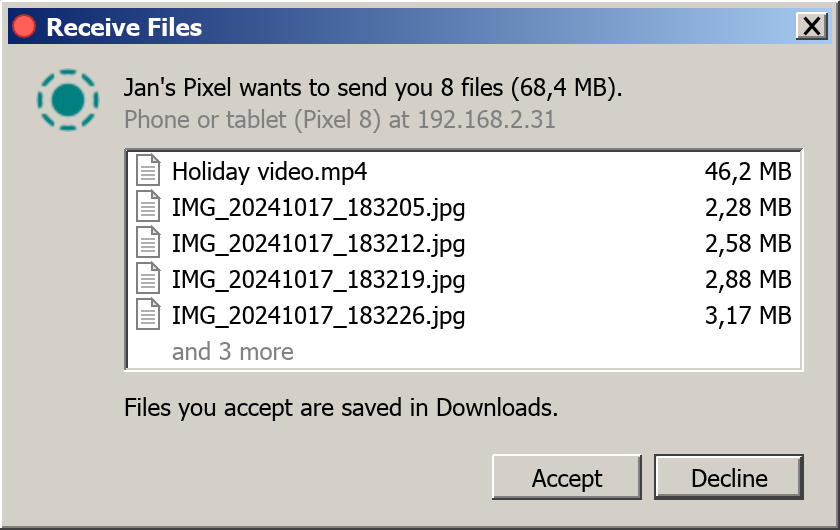

Click **Accept** to take them, or **Decline**. Pressing Return or Esc declines, so a key meant for something else never lets files in. If nobody answers within two minutes, the files are declined; if the sender gives up first, the question goes away by itself.

Accepted files go into your **Downloads** folder; **Open Downloads** in the same menus takes you there. A file never replaces one that is already there: it gets a number instead, such as "photo (1).jpg". A folder arrives as a new folder with everything in it, "Photos (1)" if there already is a "Photos". The "Receiving..." window shows how far it has got, and **Cancel** stops it; files that arrived before you cancelled are kept. The status bar says how many files arrived.

Like files from a web browser, received files are marked as downloaded, so the first time you open an app or a script that came this way, your Mac checks it and asks whether you want to open it.

If a phone still doesn't list your Mac (some networks pass nothing between devices that the phone didn't ask for), right-click the phone in Network Neighborhood and choose **Let Device Find This Computer**. Macsplorer then tells the phone about your Mac directly, so it appears in LocalSend's list. This only works while Receive Files is on, and the item is gray until then.

Only one Macsplorer window takes files for your Mac at a time; if you close it, another open window takes over within a few seconds. If LocalSend itself is open on the same Mac, both can receive; Macsplorer then uses another port, and a few devices may not find it until you close LocalSend. The first time, your Mac may ask whether Macsplorer may accept incoming network connections: choose **Allow**.

### Between windows and Finder

Copy and Cut use the Mac's own clipboard, so you can copy in one Macsplorer window and paste in another, or copy in Finder and paste in Macsplorer, and the other way round.

Finder has no Cut. Items you cut in Macsplorer are pasted as copies in Finder; to move them there, use **Edit › Move Item Here** (⌥⌘V) in Finder. The same goes for Macsplorer: items copied (or cut with a helper such as Command X) in Finder are pasted here as copies, and **Edit › Move Here** (⌥⌘V) moves them instead. It is also in the right-click menus.

### Copy as Path

**Edit › Copy as Path** (⌘⌥C) copies the full location of the selected items as text, for pasting into an email, a document or a chat.

### Delete

Select the items and press the forward **Delete** key (⌦), press ⌘⌫, or choose **Edit › Delete**. They go to the Trash, just as in Finder, so you can get them back with Undo or from the **Trash** in the Folders pane.

macOS keeps the Trash private. The first time you open it, Macsplorer may say "Operation not permitted". To allow it, open **System Settings › Privacy & Security › Full Disk Access**, switch on Macsplorer (or the terminal you started it from), and start Macsplorer again.

## 9. Undo

Made a mistake? Click **Undo** on the toolbar, choose **Edit › Undo**, or press ⌘Z. The menu says what will be undone, for example "Undo Rename".

Undo works for renaming, moving, copying and deleting, and goes back up to 10 steps. Undoing a delete brings the items back out of the Trash.

## 10. Properties

To see the details of an item, select it and press ⌘I, choose **File › Properties**, or right-click it and choose **Properties**. With nothing selected, you get the properties of the folder you're in.

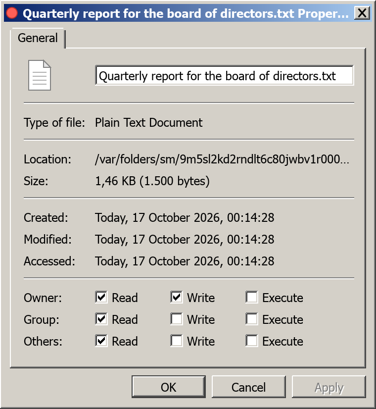 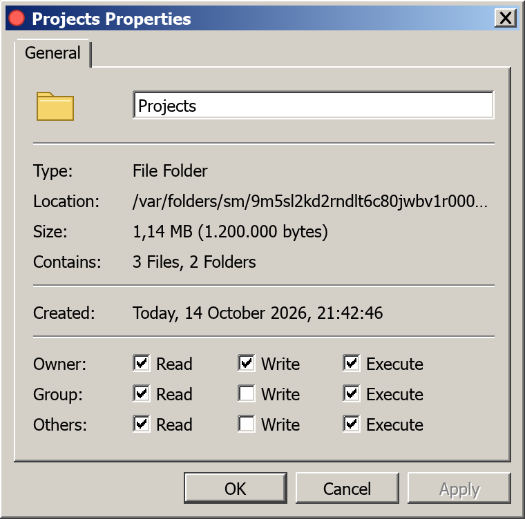

The window shows:

- **The name**, in a box you can type in to rename the item.
- **The type**: what kind of file it is.
- **Location**: the folder it is in.
- **Size**: for a folder, the total of everything inside it, plus how many files and folders it **Contains**. Big folders take a moment to count. The numbers go up while it counts.
- **Created, Modified, Accessed**: when the item was made, last changed and last opened.
- **Permissions**: who may **Read** the item, **Write** (change) it, and **Execute** it (run it as a program). "Owner" is you, "Group" is a group of users on your Mac, and "Others" is everyone else. Check or uncheck the boxes to change them.

Click **OK** to save your changes and close the window, **Apply** to save them and keep it open, or **Cancel** to close without saving.

If you select several items first, the window shows them together: their combined size and how many files and folders they contain.

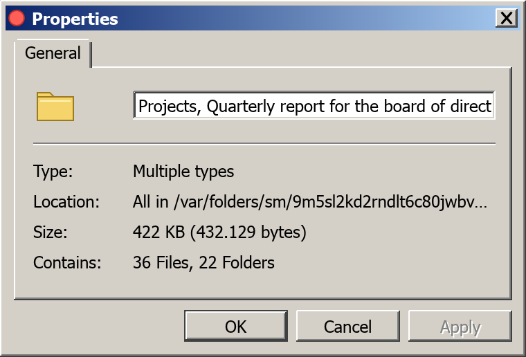

### Customizing a folder

A folder's Properties window has a second tab, **Customize**, where you give the folder a color and a picture, the same way Finder's **Customize Folder** does. Finder shows the changes too, and folders you customized in Finder show up here with their settings.

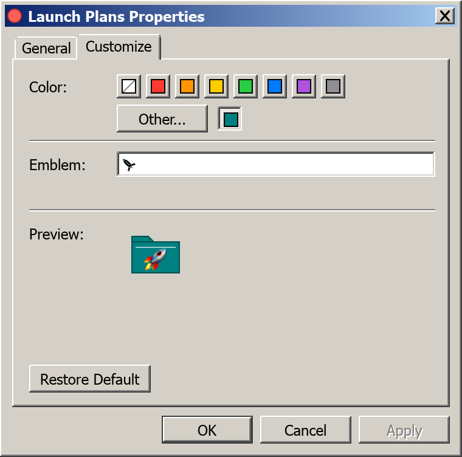

- **Color**: click a color square, or the white one with the line through it for no color. These are Finder's colors: the color is a Finder tag, so the folder also shows that tag in Finder.
- **Other...** opens the Color window for any other color: pick one of the basic colors, or click **Define Custom Colors >>** to pick from the whole range or type the numbers. **Add to Custom Colors** keeps a color in the boxes below for next time. The color you picked shows as a square next to the button. Finder only knows its own seven colors, so Finder shows the one that looks most like yours. If you change the color in Finder later, Finder's color is used from then on.
- **Emblem**: the picture drawn on the folder, on its front below the tab. Click the box and type one of two things, then look at **Preview** to see how it turns out. Leave the box empty for a plain folder.
  - **An emoji.** Press Control-Command-Space to open the Mac's emoji picker, or paste one. Emoji keep their own colors on the folder. Examples: 🚀 for a project, 🍲 for recipes, 📝 for notes, 💰 for money matters. Type one emoji only.
  - **The name of an SF Symbol.** These are Apple's built-in line pictures, such as `star.fill`, `house.fill`, `heart.fill`, `camera.fill`, `book.fill` or `figure.outdoor.cycle`. A symbol is drawn in the dark blue of the title bar, whatever the folder's color. Names are written in lowercase with dots between the words. To find a name, open the free **SF Symbols** app from Apple, or search the web for "SF Symbols" and the thing you want. If this Mac doesn't have a symbol with the name you typed, a red line under the box says so, and the folder stays without an emblem until you fix the name.
- **Preview** shows the folder as Macsplorer draws it.
- **Restore Default** takes the color and the emblem off.

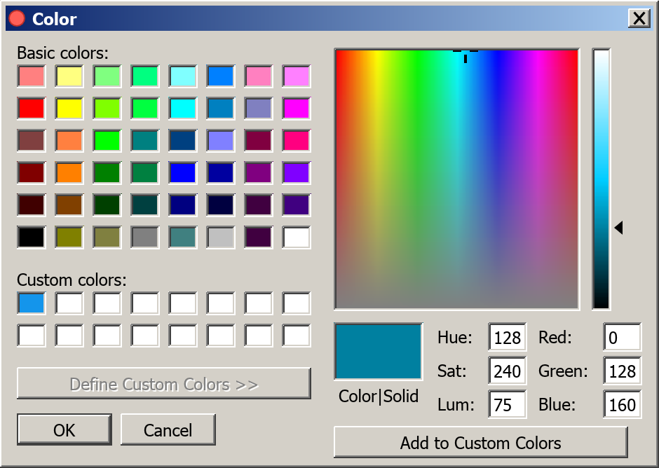

Click **OK** or **Apply** to save. Macsplorer always draws the Windows 2000 folder, in the color you picked and with the emblem on it; Finder draws its own look. **Large Icons** also shows the emblem; **List** and **Details** show only the color, and in the **Folders** pane the folders under **Favorites** show just the emblem, on the plain yellow folder (no color). The tab isn't there for apps or other packages.

On Linux the tab has colors only: no emblem, and no Finder. A colored folder is the yellow folder in its color. The color is kept with the folder itself, so it stays when you move or copy the folder within Macsplorer, but some disks (USB sticks formatted for Windows, some network drives) can't keep it; Macsplorer then says so in the status bar.

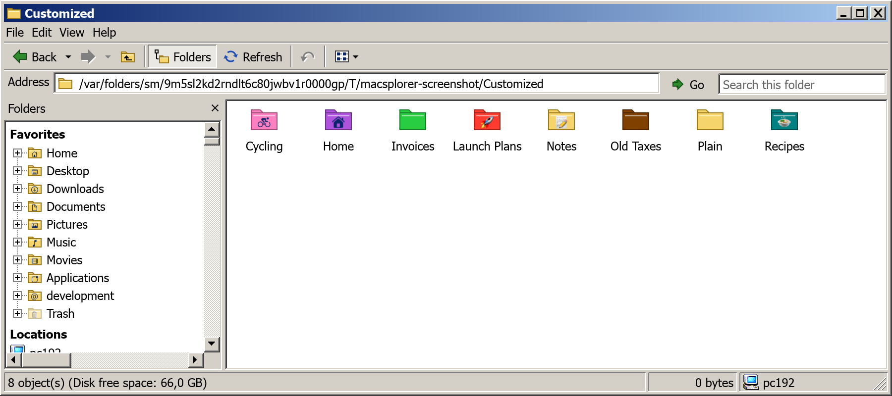

## 11. Finding files

Type in the **Search this folder** box at the top right. The list shows only the items in the current folder whose names contain what you typed, upper or lower case doesn't matter. Clear the box to see everything again.

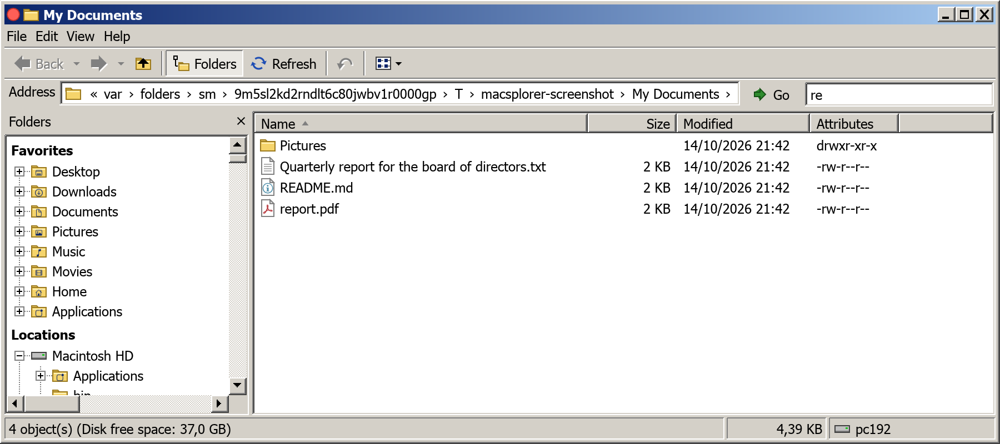

⌘F or F3 takes you to the search box from anywhere in the window, and so does a **/** typed in the file list or the Folders pane (a name can't contain a slash, so it never gets in the way of typing the first letters of a name). Then:

- **Enter** or **↓** leaves the box with the search still on, selects the first item shown and moves the keyboard to the list, so a second Enter opens it.
- **Esc** clears the search and goes back to the list.

To jump to an item without hiding the others, just type the first letters of its name in the list (see [Selecting files](#5-selecting-files)).

## 12. Making it your own

All of these are in the **View** menu.

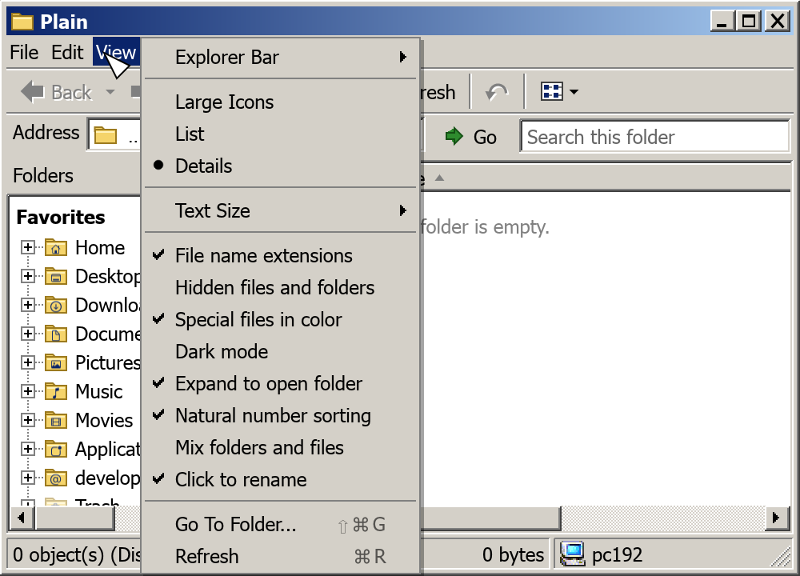

| Option | What it does |
|---|---|
| **Explorer Bar › Folders** | Shows or hides the Folders pane. |
| **Large Icons, List, Details** | Picks a view (see [Choosing how files are shown](#4-choosing-how-files-are-shown)). |
| **Text Size** | Makes everything bigger (see below). |
| **File name extensions** | Shows the ending of file names, such as `.pdf` or `.jpg`. When you hide them, an ending is still shown where hiding it could be misleading, such as an app named `Invoice.pdf.app`. |
| **Hidden files and folders** | Shows the items your Mac normally hides, such as settings files whose names start with a dot. They appear faded so you can tell them apart. On Linux this also covers names listed in a folder's `.hidden` file and backup files ending in `~`, as in Nautilus. |
| **Special files in color** | Turns the [colored names](#colored-names) on or off. |
| **Dark mode** | Light text on a dark background. |
| **Expand to open folder** | Lets the Folders pane follow you to the folder you're in. |
| **Natural number sorting** | Sorts numbers in names by their value, so "File 2" comes before "File 10". Turn it off to sort letter by letter. |
| **Mix folders and files** | Sorts folders in between the files instead of putting them all at the top. |
| **Click to rename** | Clicking the name of a selected item, then waiting a moment, starts [renaming](#7-renaming) it. Turn it off if that happens when you don't want it; **F2** and **Rename** still work. Macsplorer remembers this choice. |
| **Refresh** | Reloads the list. |

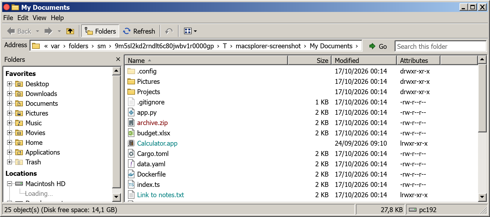

### Text Size

If the text is too small to read comfortably, choose **View › Text Size** and pick **Large (125%)**, **Larger (150%)** or **Largest (200%)**. Everything grows together, the text as well as the icons, buttons and spacing, so the window keeps its look. **Normal (100%)** sets it back.

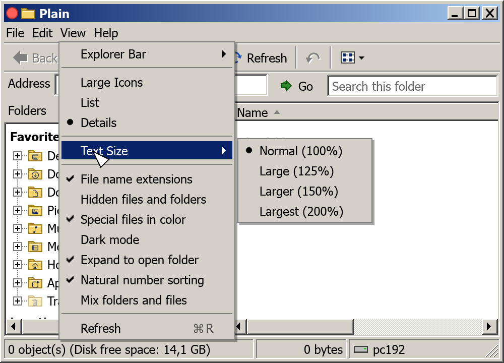

You can also press **⌘+** to go one size up, **⌘−** to go one size down, and **⌘0** to return to Normal. You may want to make the window bigger after choosing a larger size.

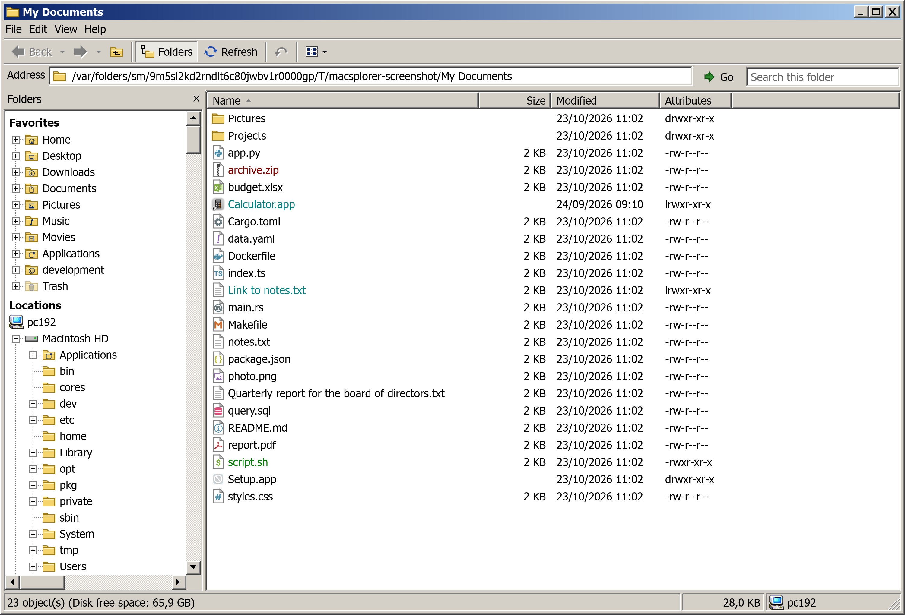

### Using another terminal

**Open in Terminal** starts the Terminal app. To use another one, add its app name to `~/Library/Application Support/macsplorer/settings.json`, for example `"terminal": "iTerm"` or `"terminal": "Ghostty"`. The name is the one shown in the Applications folder, without `.app`. **Help › Open config file** opens that file in your text editor. The next **Open in Terminal** uses it, no restart needed. If the name is wrong, the status bar says so.

### Choosing which app opens which files

The **Open With** dialog remembers one app per kind of file (see chapter 6). You can also set several at once by editing `~/Library/Application Support/macsplorer/settings.json` (**Help › Open config file** opens it). Add an `associations` list that matches a file type to an app. For example, to open all the common picture formats in Preview:

```json
"associations": {
  "public.jpeg": "/System/Applications/Preview.app",
  "public.png": "/System/Applications/Preview.app",
  "com.compuserve.gif": "/System/Applications/Preview.app",
  "public.tiff": "/System/Applications/Preview.app",
  "com.microsoft.bmp": "/System/Applications/Preview.app",
  "public.heic": "/System/Applications/Preview.app",
  "org.webmproject.webp": "/System/Applications/Preview.app",
  "public.svg-image": "/System/Applications/Preview.app"
}
```

Each line is a file type, then the app's full path. File types are the names macOS uses for them, so `.jpg` and `.jpeg` files are both `public.jpeg`. Each type needs its own line. To find the name for another kind of file, run `mdls -raw -name kMDItemContentType` followed by a file's path in Terminal, or tick **Always use this program** once in the Open With dialog and look at the line it adds.

Keep the commas between lines and put the list inside the outer `{ }`. A mistake in the file makes Macsplorer ignore all your settings until it is fixed. A change counts the next time you open a file, no restart needed. If the app is no longer installed, the file opens the normal way.

### Dark mode

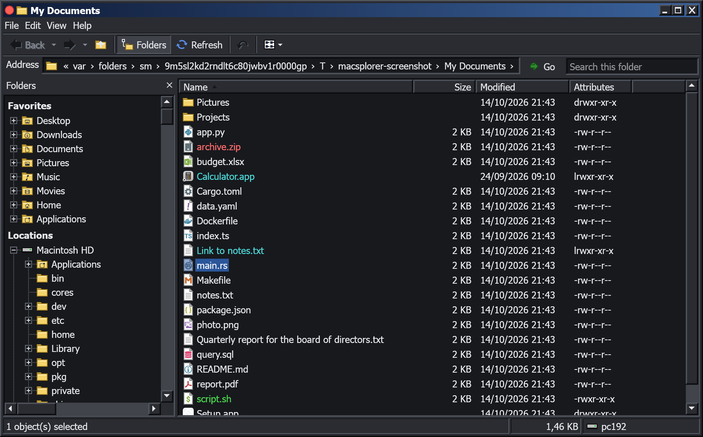

Macsplorer remembers your text size, dark mode, columns, view, sort order and window size the next time you open it. Windows that are already open pick up a change the next time they're opened.

## 13. Keyboard shortcuts

You can use Macsplorer without the mouse. **Tab** moves from the file list to the address bar, then to the search box, then to the Folders pane and back to the list; **⇧Tab** goes the other way. F6 does the same as Tab. The part of the window you're in shows a dotted rectangle around the item that the keys work on, and the selection in the other parts turns gray.

**Moving around**

| Keys | Action |
|---|---|
| ⌘[ or ⌥← or ⌫ | Back |
| ⌘] or ⌥→ | Forward |
| ⌘↑ or ⌥↑ | Up to the containing folder |
| Tab or F6 | Go to the next part of the window (⇧ goes back) |
| ⌘L or F4 or ⌥D | Type a location in the address bar |
| ⌘F or F3 or / | Search this folder (in the box: Enter or ↓ to the list, Esc clears it) |
| ⇧⌘G | Go To Folder: jump to a folder by a few letters of its name |
| ? or F1 | Show this list of shortcuts in a window |
| ⌘R or F5 | Refresh |
| Arrow keys | Move the selection (in the tree: → unfolds, ← folds) |
| Home, End, Page Up, Page Down | First item, last item, a pageful up or down |
| Space | Select the item with the focus rectangle, or take it out of the selection |
| ⇧ with arrow keys or Space | Select a range |
| + and − | In the Folders pane: unfold and fold |
| Letters | Jump to the first item whose name starts with them |

**Working with files**

| Keys | Action |
|---|---|
| Enter | Open the selected item |
| F2 | Rename |
| ⌘A | Select all |
| ⌘C | Copy |
| ⌘X | Cut |
| ⌘V | Paste |
| ⌥⌘V | Move Here (paste as a move) |
| ⌘⌥C | Copy as Path |
| ⌦ or ⌘⌫ | Move to Trash |
| ⌘Z | Undo |
| ⌘I | Properties |

**Window**

| Keys | Action |
|---|---|
| ⌘E (or ⌘N) | New window |
| ⌘+ / ⌘− / ⌘0 | Bigger text, smaller text, normal text |
| ⌘Q | Close |

On Linux, use Ctrl wherever this manual says ⌘.

## 14. Questions and answers

**I added a file in another app. Do I need to refresh?**
No. Macsplorer notices changes in the folder you're looking at and in the folders open in the Folders pane, and updates within a second. **Refresh** (⌘R) is still there for everything else.

**Can I drag files to move them?**
Yes, see [Dragging](#dragging). On the same disk dragging moves; hold ⌥ Option to copy instead.

**What happens if I paste a file where one with the same name already exists?**
Macsplorer asks whether to replace it. If you say yes, the old one goes to the Trash, so ⌘Z can bring it back. See [When the name is already taken](#when-the-name-is-already-taken).

**I deleted something by mistake.**
Press ⌘Z right away, or open the **Trash** in the Folders pane.

**Some of my files are missing from the list.**
Check that the search box is empty, then turn on **View › Hidden files and folders** to see the items your Mac normally hides.

**The Git summary or the Branch column is missing.**
Both need Git to be installed on your Mac. Macsplorer looks for it when it starts, so if you install Git while Macsplorer is open, close and reopen it. If you have Git and they still don't show, [Git repositories](#git-repositories) explains when they appear. After changes made by other programs, press ⌘R to bring the summary up to date.

**My phone can't find my Mac in LocalSend.**
Check that **Receive Files** is on: the computer at the right end of the status bar has a hand under it. Then refresh the list in LocalSend on the phone. Both have to be on the same network, as for sending.

**My phone doesn't show up in Network Neighborhood.**
Check that LocalSend is open on it and that both are on the same network (guest Wi-Fi networks often keep devices apart). Then right-click Network Neighborhood and choose **Search Again**. If your Mac asked about finding devices on your local network and you said no, see [Sending to a phone or computer nearby](#sending-to-a-phone-or-computer-nearby).

**Which version do I have?**
Choose **Help › About Macsplorer**. A small window shows the app icon, the version, the locale (the region that dates and numbers follow, and the language names are sorted by) and the font the text is set in. When the font comes from a file, its location is a link: click it and the window closes and the font's folder opens with the file selected. Press OK, Return or Escape to close the window.

**Is there a newer version?**
Open **Help › About Macsplorer** and press **Check for Updates**. Macsplorer asks the project's releases page on GitHub for the newest version and says either that you have the latest one or which version is available, with a link to its download page. Macsplorer never checks by itself: nothing is sent until you press the button. The check needs `curl`, which every Mac has.

The address it asks is the `update_url` entry in `~/Library/Application Support/macsplorer/settings.json` (**Help › Open config file** opens it). If the GitHub page ever disappears, change it to the address of a file that says what the newest version is, for example `{"version": "1.5.0", "url": "https://example.org/macsplorer"}`. GitHub's own "latest release" format works as well.
